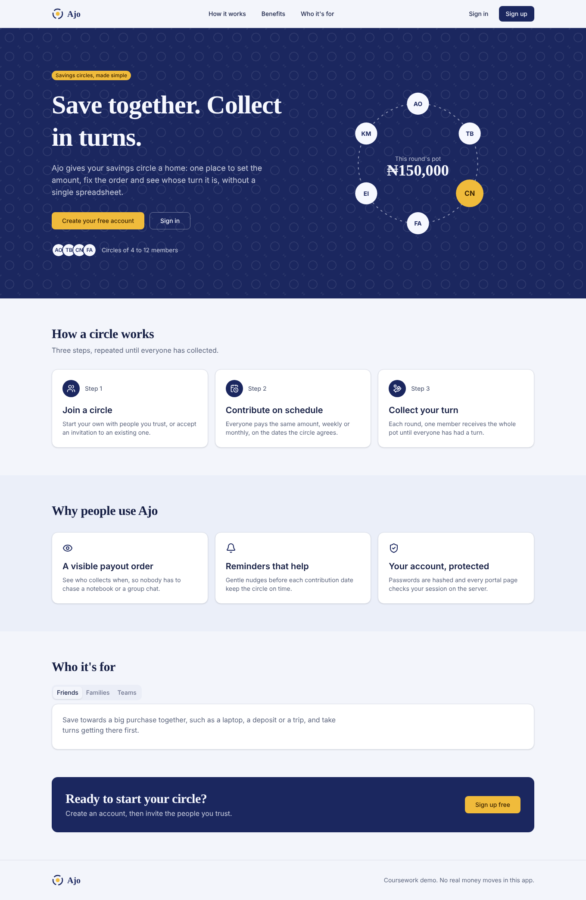
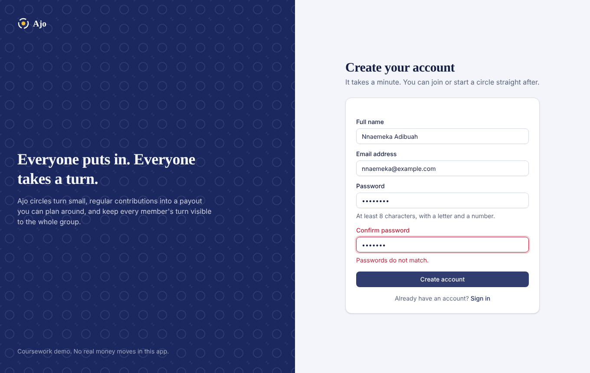
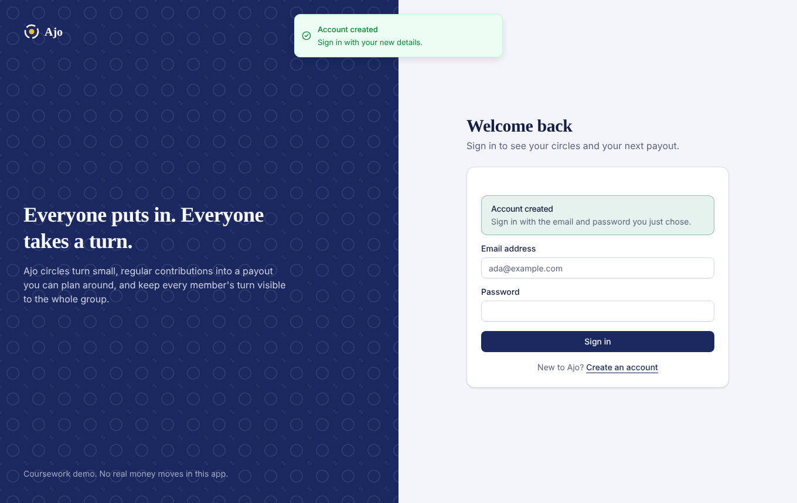
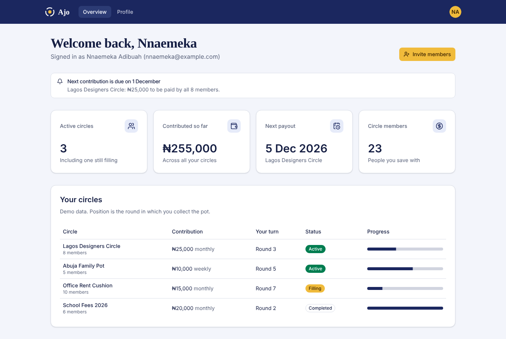
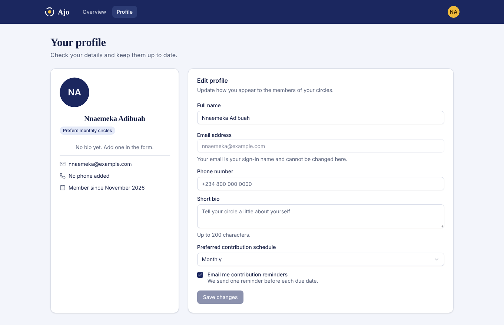

# Ajo: Creative Onboarding Platform

Ajo is a platform for rotating savings circles (called *ajo* or *esusu* in Nigeria). Members contribute a fixed amount on a schedule and take turns collecting the pot. This project takes a visitor through the whole journey: **discover the platform, sign up, sign in, use the portal, manage a profile and sign out.**

Built with Next.js (App Router), React, TypeScript, Tailwind CSS, shadcn/ui and Auth.js.

> Coursework demo. The circles and amounts in the portal are sample data, and no real money moves.

## Screenshots

| Landing page | Sign up validation |
| --- | --- |
|  |  |

| Sign in | Portal |
| --- | --- |
|  |  |

| Profile |
| --- |
|  |

## Features

- **Landing (`/`)**: hero with a circle graphic, how-it-works steps, benefits, audience tabs, sign-up and sign-in actions, responsive navigation with a mobile sheet menu.
- **Sign up (`/signup`)**: full name, email, password, confirm password. Client and server validation with zod, inline messages, duplicate email detection, toast and alert feedback, redirect to `/signin` on success.
- **Sign in (`/signin`)**: credential check against the database, loading state, clear error message, link to sign up.
- **Portal (`/portal`)**: personalised welcome, name and email, stat cards, reminder alert, circles table with status badges and progress bars, invite dialog.
- **Profile (`/portal/profile`)**: profile card plus a form for name, phone, bio, schedule and reminder preference. Changes are saved per account with feedback.
- **Sign out**: account menu with a confirmation dialog. The session cookie is cleared and `/portal` is no longer reachable.

## Authentication and security

- **Auth.js (next-auth v5)** with the Credentials provider and signed, httpOnly JWT session cookies.
- Passwords are hashed with **bcrypt** (cost 12). Plain-text passwords are never stored or logged.
- Users and profile data live in a local **SQLite** database (`data/ajo.db`, created on first run, git-ignored).
- **Protected routes, two layers:** `proxy.ts` redirects signed-out visitors, and the portal layout calls `requireUser()` on the server, which verifies the session and that the account still exists. Hiding a link is never the only protection.
- Every profile update runs in a server action that reads the user id from the session, so users can only change their own data.
- Secrets live in `.env.local`, which is git-ignored. Only `.env.example` is committed.

For production, replace SQLite with a hosted database (SQLite files do not persist on serverless platforms) and add email verification and rate limiting.

## shadcn/ui components used

Button, Card, Input, Label, Form, Textarea, Checkbox, Select, Tabs, Dialog, Alert Dialog, Alert, Badge, Avatar, Dropdown Menu, Navigation Menu, Sheet, Separator, Table, Progress, Skeleton, Sonner (toasts).

## React and Next.js concepts demonstrated

- Reusable, typed components: `TextField` (used in every form), `StatCard`, `ProfileCard`, `PortalNavItem`, `Logo`, `AuthShell`, `CircleRing`, `InviteDialog`.
- Props of several kinds: strings, numbers, arrays, icon components and callbacks (`onSubmit`, `onCheckedChange`).
- App Router with route groups `(marketing)` and `(auth)`, a nested `portal` layout, `loading.tsx` and `Link` navigation.
- Server Components for pages and data access; `"use client"` only for forms, menus and dialogs.
- Server Actions for registration, sign in, sign out and profile updates.

## Getting started

```bash
git clone https://github.com/<your-username>/creative-onboarding-platform.git
cd creative-onboarding-platform
npm install
cp .env.example .env.local     # then set AUTH_SECRET (npx auth secret, or openssl rand -base64 32)
npm run dev
```

Open http://localhost:3000. If you run `npm run build && npm start` locally, add `AUTH_TRUST_HOST=true` to `.env.local`.

## Project structure

```
proxy.ts               redirects for /portal, /signin, /signup
src/
  auth.ts, auth.config.ts   Auth.js setup
  actions/             server actions (auth, profile)
  app/                 (marketing)/, (auth)/signin, (auth)/signup, portal/, portal/profile
  components/          reusable components and components/ui (shadcn/ui)
  lib/                 db, users, validation, session guard, demo data
```
